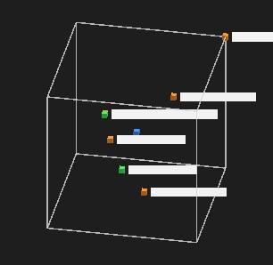

# Cube

[](https://github.com/pearstopher/ffxiv-cube/actions/workflows/build.yml)
[](https://github.com/pearstopher/ffxiv-cube/releases/latest)

A [Dalamud](https://github.com/goatcorp/Dalamud) plugin for FINAL FANTASY XIV that draws a window showing a
3D cube of space around your character, with the players near you inside it as small labelled cubes.



*Drawn by the project's snapshot tool from a real game frame; in game the bars are the players' names.*

## What it does

- **Type `/cube`** to show or hide the cube window.
- **You are the cube in the middle.** The big cube is centred on you and moves with you, 40 yalms across by default.
- **Players inside the cube are shown as small cubes** with their names next to them. Players outside it aren't shown.
- **Colours tell you who's who:** one colour for you, one for party and alliance members, one for everyone else.
- **Near things cover far things,** so you can see which players are in front.
- **Turn the view with the little x/y/z cube** in the corner of the window: drag it to look from any side, above or
  below, or click one of its faces to look straight at that side. Your view is remembered.
- **Nothing is drawn while you're logged out, loading, in a cutscene or in GPose.**

It only reads what the game already knows and draws it in its own window. It never changes anything in the game,
never sends anything to the server, and never automates anything. Names are only drawn on screen; they're never
saved or sent anywhere.

## Settings

Type `/cube config` (or use the settings button in `/xlplugins`). Changes show straight away.

| Setting | What it does | Default |
| --- | --- | --- |
| Cube size (yalms) | How far the cube reaches around you, edge to edge (10–100). | 40 |
| Orientation | The cube itself stays still on screen; this decides what happens to what's inside it. **Rotate contents with camera:** forward in the cube is where the game camera looks, so when you turn the camera everything inside turns around you. **Keep contents fixed (north stays put):** north is always the same side of the cube and the camera changes nothing. | Rotate contents with camera |
| View control corner | Which corner of the cube window the x/y/z view control sits in. | Bottom right |
| Reset view | Puts the view back to the default: from behind and above, at 30°. | |
| Show names | Name labels next to the players' cubes. | On |
| You / Party / alliance / Others | The colour for each kind of player. | Blue / green / orange |
| Opacity | How see-through everything in the window is. | 1.00 |
| Reset to defaults | Puts every setting back. | |

## Installing

This is a personal plugin. It follows the official Dalamud plugin rules but isn't in the official plugin list, so
it's installed from its own custom repository:

1. In game, type `/xlsettings` and open the **Experimental** tab.
2. Under **Custom Plugin Repositories**, paste this URL, tick **Enabled**, and click **Save**:

   ```
   https://raw.githubusercontent.com/pearstopher/ffxiv-cube/main/repo.json
   ```

3. Type `/xlplugins`, search for **Cube** and install it.
4. Type `/cube`.

## Problems or ideas

Please [report a bug](https://github.com/pearstopher/ffxiv-cube/issues/new?template=bug.md). The form asks for your
versions, settings, what happened, and the relevant lines from `dalamud.log`.

## Contributing

- **Building and testing:** see the [development guide](https://github.com/pearstopher/ffxiv-cube/blob/main/DEVELOPMENT.md).
- **How it works:** see the [code reference](https://github.com/pearstopher/ffxiv-cube/blob/main/docs/reference/README.md), generated from the code's comments.

## License

[AGPL-3.0](https://github.com/pearstopher/ffxiv-cube/blob/main/LICENSE.md)
